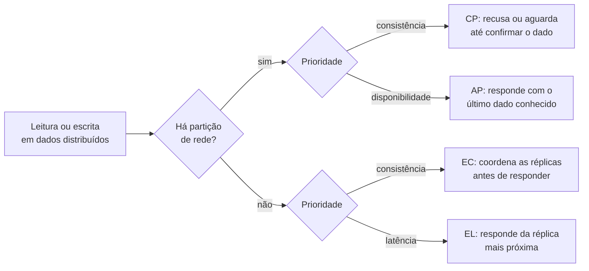

# Custos e Riscos de Microsserviços

Guia de referência rápida sobre **o que a distribuição cobra em troca da autonomia**: falácias da computação distribuída, teorema CAP, PACELC e consistência eventual, fronteiras de serviço e monolito distribuído, custos, segurança, dados pessoais e governança tecnológica.

> [!NOTE]
> Síntese pessoal de conceitos consolidados na literatura de arquitetura de software e de sistemas distribuídos. As fontes estão nas [referências](#referências). Complementa os guias [Fundamentos de Arquitetura de Software](https://github.com/sidartaoss/fundamentos-arquitetura-software), [Monolitos e Microsserviços](https://github.com/sidartaoss/monolitos-e-microsservicos) e [Práticas e Tecnologias para Microsserviços](https://github.com/sidartaoss/praticas-e-tecnologias-para-microsservicos).

## Em resumo

- **Distribuir acrescenta custo e risco.** Implantação, escala e evolução independentes vêm acompanhadas de comunicação pela rede, consistência eventual e complexidade operacional.
- **A rede não é confiável.** Toda chamada remota pode falhar, demorar, ser interceptada ou custar caro.
- **Durante uma partição, escolhe-se entre consistência e disponibilidade.** A escolha é feita por operação, e não para o sistema inteiro, e envolve o negócio.
- **Fronteiras erradas custam caro.** Serviços mal delimitados formam um monolito distribuído, e corrigi-los exige migrar dados, versionar contratos e coordenar times.
- **Custo, segurança, privacidade e tecnologia são requisitos de arquitetura.** Cada serviço adicional amplia a operação, a superfície de ataque, as cópias de dados pessoais e as stacks a governar.

## 1. Falácias da computação distribuída

Dentro de um processo, uma chamada de método leva nanossegundos. Entre serviços, leva de frações de milissegundo, no mesmo data center, a mais de cem milissegundos, entre continentes, e pode falhar, demorar ou ser repetida. L Peter Deutsch e colegas da Sun Microsystems reuniram em 1994 sete suposições equivocadas comuns a quem constrói sistemas distribuídos; James Gosling acrescentou a oitava por volta de 1997.

| Falácia | Na prática | Mitigações comuns |
|---|---|---|
| A rede é confiável | Conexões caem e mensagens se perdem; falhas se propagam em cascata | *Timeouts*, retentativas idempotentes com *backoff*, *circuit breaker*, mensageria |
| A latência é zero | Cada chamada soma tempo à resposta, e cadeias de chamadas o multiplicam | Menos chamadas encadeadas, comunicação assíncrona, cache |
| A largura de banda é infinita | Payloads volumosos saturam a rede e degradam outros serviços | Respostas enxutas, paginação, compressão |
| A rede é segura | O tráfego pode ser interceptado ou adulterado | TLS e mTLS; autenticação e autorização em cada chamada |
| A topologia não muda | Instâncias sobem, caem e mudam de endereço | Descoberta de serviços, DNS, balanceamento de carga |
| Existe um único administrador | Times, provedores e políticas distintos mudam a rede sem coordenação | Infraestrutura como código, padrões comuns, observabilidade |
| O custo de transporte é zero | Serialização consome CPU, e o tráfego entre zonas e regiões é cobrado | Menos tráfego, formatos compactos, custo de rede monitorado |
| A rede é homogênea | Regiões, provedores e ambientes híbridos diferem em latência, segurança e protocolos | Protocolos abertos, *fallbacks*, testes com a rede degradada |

O efeito cresce com o número de serviços:

- **Disponibilidade composta.** Uma requisição que precisa de cinco serviços com 99,9% de disponibilidade cada fica com cerca de 99,5%: a indisponibilidade mensal passa de cerca de 43 minutos para cerca de 3,6 horas.
- **Latência de cauda.** Jeffrey Dean e Luiz André Barroso mostram que, se cada servidor demora mais de um segundo em 1% das respostas e uma requisição depende de 100 servidores em paralelo, 63% das requisições levarão mais de um segundo.

## 2. Consistência e disponibilidade: CAP e PACELC

Conjecturado por Eric Brewer em 2000 e demonstrado por Seth Gilbert e Nancy Lynch em 2002, o teorema CAP estabelece que, **durante uma partição de rede, um sistema distribuído não consegue garantir ao mesmo tempo consistência e disponibilidade**.

| Propriedade | Significado no teorema |
|---|---|
| **C**: consistência | Toda leitura retorna a escrita mais recente, ou um erro; equivale à linearizabilidade, e não ao "C" de ACID |
| **A**: disponibilidade | Toda requisição a um nó em funcionamento recebe resposta, ainda que sem a escrita mais recente |
| **P**: tolerância a partições | O sistema segue operando mesmo com mensagens perdidas ou atrasadas entre os nós |

Partições são inevitáveis na comunicação pela rede; a escolha real, durante uma delas, é entre consistência e disponibilidade:

| | CP | AP |
|---|---|---|
| Durante a partição | Recusa ou aguarda a operação até confirmar o dado | Responde com o último dado conhecido |
| Risco aceito | Indisponibilidade temporária | Divergência temporária, a reconciliar depois |
| Indicado quando | Uma violação é inaceitável ou cara de compensar | A divergência é tolerável ou compensável |

O **PACELC**, de Daniel Abadi, completa o quadro: havendo partição (*P*), escolhe-se entre disponibilidade (*A*) e consistência (*C*); senão (*E*, de *else*), entre latência (*L*) e consistência (*C*), porque coordenar réplicas leva tempo mesmo sem falhas.

- **A escolha é granular.** Para Brewer (2012), a fórmula "2 de 3" sempre foi enganosa: sem partição, é possível ter consistência e disponibilidade, e a escolha pode variar entre operações e dados de um mesmo sistema. Na partição, ele recomenda detectá-la, operar em modo restrito e, depois, recuperar a consistência e compensar as violações.
- **Consistência eventual.** Na definição de Werner Vogels, sem novas atualizações, todas as leituras acabam retornando o último valor escrito; adotá-la exige planejar a reconciliação, com idempotência e compensações.
- **Decisão de negócio.** Quanto custam uma divergência e uma indisponibilidade são perguntas de negócio, e não apenas técnicas.

## 3. Fronteiras de serviço e o monolito distribuído

> "Qualquer refatoração de funcionalidades entre serviços é muito mais difícil do que em um monolito." — Martin Fowler

Não há fórmula para definir onde um serviço começa e termina; a modelagem depende do domínio. Fronteiras mal traçadas produzem o que Sam Newman chama de **monolito distribuído**: serviços que precisam ser implantados juntos e que somam a complexidade da distribuição à rigidez do monolito.

| Sinal | O que costuma indicar |
|---|---|
| Deploys coordenados entre serviços | Fronteiras que cortam uma capacidade de negócio, ou contratos instáveis |
| Operações simples que disparam cadeias de chamadas síncronas | Dependência excessiva; latência e falhas acumuladas a cada salto |
| Regra de negócio espalhada por vários serviços | Baixa coesão: mudar uma funcionalidade exige percorrer várias bases de código |
| Banco ou biblioteca de domínio compartilhados | Acoplamento oculto, que impede a evolução independente |

Para decidir a granularidade, Neal Ford, Mark Richards, Pramod Sadalage e Zhamak Dehghani propõem pesar forças opostas:

| Forças | Exemplos |
|---|---|
| **Desintegradoras** (favorecem dividir) | Escopo e função distintos, volatilidade do código, escala e vazão, tolerância a falhas, segurança, extensibilidade |
| **Integradoras** (favorecem manter junto) | Transações de banco de dados, fluxos de trabalho com muita comunicação, código compartilhado, relacionamentos entre dados |

Uma regra prática decorre das seções anteriores: **invariantes que exigem consistência forte ficam dentro de uma única fronteira**, como nos agregados do *Domain-Driven Design*, protegidas por uma transação local, sem depender da rede.

**Fronteiras evoluem.** Com o negócio, serviços crescem e precisam ser divididos, ou foram separados sem necessidade e precisam ser unidos. Entre serviços, segundo James Lewis e Martin Fowler, mover código exige coordenar mudanças de interface, manter camadas de compatibilidade e testar de forma mais complexa, além de migrar dados com a operação no ar. Reduzem o risco a **mudança em paralelo** (*expand/contract*, de Danilo Sato: expandir o contrato, migrar os consumidores e só então remover a forma antiga), os testes de contrato, o versionamento de APIs e a migração incremental de dados.

## 4. Custos: infraestrutura, operação e pessoas

Martin Fowler chama de *microservice premium* o acréscimo de custo e de risco que o estilo impõe, e recomenda nem considerá-lo a menos que o sistema seja complexo demais para ser gerenciado como monolito.

| Categoria | Monolito | Microsserviços |
|---|---|---|
| Infraestrutura | Poucas instâncias e, em geral, um banco | Instâncias, bancos e réplicas por serviço; dados duplicados; balanceadores; tráfego entre serviços |
| Operação | Um pipeline e um conjunto de logs | Orquestração, observabilidade distribuída, pipelines, configuração e segredos por serviço |
| Pessoas | Competências mais difundidas | Experiência em sistemas distribuídos e em operação; curva de aprendizado; plantão para dezenas de serviços |

- **Escala independente não garante economia.** Cada serviço mantém um piso de custo (instâncias mínimas, banco, monitoramento), mesmo ocioso.
- **Distribuição em excesso encarece.** Em 2023, um time do Prime Video relatou redução de 90% no custo de infraestrutura ao reunir em um único processo uma ferramenta antes distribuída em componentes serverless; o custo vinha, sobretudo, do armazenamento intermediário de quadros de vídeo e das transições de estado da orquestração.
- **Medir para decidir.** Custos por serviço e por transação, segundo as práticas de FinOps, mostram se a autonomia compensa o gasto adicional.

## 5. Segurança

Com microsserviços, cada interação atravessa a rede, e a superfície de ataque cresce com o número de serviços, APIs e credenciais. O NIST trata do tema na SP 800-204, e da arquitetura *zero trust*, na SP 800-207.

| Risco | Mitigações comuns |
|---|---|
| Interceptação ou adulteração do tráfego (*man-in-the-middle*) | TLS em toda comunicação; mTLS entre serviços, em geral via *service mesh* |
| Serviço comprometido explorando a confiança dos demais | *Zero trust*: identidade para cada workload (SPIFFE) e autorização de cada chamada |
| Controle de acesso inconsistente entre dezenas de APIs | Autenticação na borda (API gateway), tokens validados em cada serviço, políticas centralizadas (Open Policy Agent), privilégio mínimo |
| Segredos dispersos em código e configuração | Cofre de segredos, rotação automática, varredura de segredos nos repositórios |
| Vulnerabilidades em serviços com ciclos próprios | Inventário de serviços e APIs, SBOM, varredura de dependências e de imagens |
| Automação abusiva de fluxos de negócio | Limites de taxa e detecção de robôs (OWASP API Security Top 10, API6:2023) |

## 6. Dados pessoais distribuídos: LGPD e GDPR

Com um banco por serviço, dados pessoais se espalham por bancos, caches, eventos, logs e backups, e obrigações antes cumpridas em um só lugar passam a exigir coordenação entre serviços:

| Obrigação | Resposta arquitetural |
|---|---|
| Eliminação a pedido do titular (LGPD, art. 18; GDPR, art. 17) | Inventário de onde cada dado pessoal vive; evento de eliminação consumido por todos os serviços, com confirmação; eliminação criptográfica (*crypto-shredding*) para cópias inalcançáveis, como backups |
| Necessidade e retenção (LGPD, arts. 6º, III, e 16; GDPR, art. 5º) | Guardar o identificador do titular, e não cópias dos dados; prazos de retenção por armazenamento |
| Segurança (LGPD, art. 46) | Criptografia em trânsito e em repouso; acesso mínimo; mascaramento de dados pessoais em logs e telemetria |
| Registro das operações de tratamento (LGPD, art. 37) | Catálogo de dados pessoais, com o time responsável por cada serviço |
| Comunicação de incidentes (LGPD, art. 48) | Rastreabilidade para identificar os dados e os titulares afetados |

A LGPD exige que as medidas de segurança sejam observadas "desde a fase de concepção do produto ou do serviço até a sua execução" (art. 46, § 2º); o GDPR fala em *data protection by design and by default* (art. 25).

## 7. Hype, diversidade tecnológica e governança

- **Hype Driven Development.** Marek Kirejczyk (2016) descreve decisões de arquitetura e de stack baseadas no que está em evidência, e não no impacto esperado.
- **Foco na tecnologia.** Chris Richardson inclui entre os antipadrões de adoção de microsserviços concentrar-se na tecnologia, em geral na infraestrutura de implantação, e negligenciar a decomposição em serviços.
- **Expansão desordenada de tecnologias** (*technology sprawl*). Stacks diferentes em cada serviço, escolhidas sem critério, dificultam a mobilidade entre times, o apoio de times de plataforma e o suporte.

Dan McKinley sugere tratar a inovação como recurso escasso: cada empresa tem cerca de três "fichas de inovação" (*innovation tokens*), e uma tecnologia nova só entra se o problema não puder ser resolvido com o que já existe. Na prática, combinam-se:

| Prática | Efeito |
|---|---|
| Stacks de referência com suporte da plataforma (*paved road*) | Caminho padrão, sem proibir alternativas |
| Exceções com critérios explícitos, registradas em ADR | Diversidade apenas onde agrega valor |
| Logs, métricas, *tracing* e deploy padronizados | Operação uniforme, qualquer que seja a stack |
| Radar de tecnologias, no formato do Technology Radar da Thoughtworks | Visibilidade do que adotar, experimentar, avaliar ou evitar |

## 8. Exemplo aplicado: plataforma de venda de ingressos

A plataforma dos guias anteriores combina um monolito modular (eventos, catálogo e contas) a serviços de reservas, pagamentos e notificações; a alocação de assentos é uma biblioteca do serviço de reservas ([detalhes](https://github.com/sidartaoss/praticas-e-tecnologias-para-microsservicos#9-exemplo-aplicado-plataforma-de-venda-de-ingressos)). A abertura das vendas, que concentra em minutos o tráfego de semanas, expõe todos os riscos deste guia.

**Fronteiras e consistência.** A invariante "um assento, um comprador" fica inteira no serviço de reservas, protegida por uma transação local, sem coordenação pela rede; o mapa de assentos do catálogo é um modelo de leitura alimentado por eventos de reservas. A escolha entre consistência e disponibilidade é feita por operação:

| Operação | Durante uma partição | Por quê | Custo aceito |
|---|---|---|---|
| Exibir o mapa de assentos | AP: último estado conhecido | Um mapa defasado em segundos não gera venda indevida, pois a retenção revalida o assento | Um assento exibido como livre pode ser recusado |
| Reter um assento | CP: sem confirmação do banco de reservas, a retenção é recusada | Um assento não pode ser vendido duas vezes | Compras recusadas enquanto durar a falha |
| Emitir o ingresso e notificar | AP: o evento aguarda na fila | Com o pagamento confirmado, atrasar a emissão é aceitável | Entrega eventual; consumidores idempotentes |

Mesmo sem partição, vale o PACELC: o mapa é servido de cache e de réplicas de leitura, enquanto a retenção sempre escreve no banco principal.

| Risco | Decisão | Trade-off |
|---|---|---|
| Custos | Catálogo segue no monolito modular, com cache; nada é extraído sem pressão concreta; custo por compra medido a cada grande evento | Parte do sistema segue acoplada |
| Segurança | mTLS entre serviços; fila virtual, limites por conta e detecção de robôs contra cambistas; credenciais dos gateways de pagamento em cofre | Atrito para compradores legítimos |
| Dados pessoais | Dados pessoais só em contas, e os demais serviços guardam o identificador; eliminação propagada por evento; dados fiscais conservados por obrigação legal (LGPD, art. 16, I); CPF e e-mail mascarados nos logs | Mais chamadas a contas |
| Tecnologia | Java e Spring, com o chassi interno, como stack de referência; tecnologia nova só com ADR | Menos liberdade para experimentar |

Escolhas como CP na retenção e AP no mapa de assentos são decisões de negócio tanto quanto técnicas e, por isso, devem ser registradas em um ADR, com a participação das áreas de negócio.

## Referências

- James Lewis e Martin Fowler — [Microservices](https://martinfowler.com/articles/microservices.html) (2014)
- Martin Fowler — [MonolithFirst](https://martinfowler.com/bliki/MonolithFirst.html), [Microservice Premium](https://martinfowler.com/bliki/MicroservicePremium.html) e [Microservice Trade-Offs](https://martinfowler.com/articles/microservice-trade-offs.html) (2015); Danilo Sato — [ParallelChange](https://martinfowler.com/bliki/ParallelChange.html) (2014)
- Neal Ford, Mark Richards, Pramod Sadalage e Zhamak Dehghani — *Software Architecture: The Hard Parts* (O'Reilly, 2021)
- Sam Newman — *Building Microservices*, 2ª ed. (O'Reilly, 2021); Eric Evans — *Domain-Driven Design* (Addison-Wesley, 2003)
- Jeffrey Dean e Luiz André Barroso — [The Tail at Scale](https://research.google/pubs/the-tail-at-scale/) (*Communications of the ACM*, 2013)
- Seth Gilbert e Nancy Lynch — [Brewer's Conjecture and the Feasibility of Consistent, Available, Partition-Tolerant Web Services](https://groups.csail.mit.edu/tds/papers/Gilbert/Brewer2.pdf) (*ACM SIGACT News*, 2002)
- Eric Brewer — [CAP Twelve Years Later: How the "Rules" Have Changed](https://www.infoq.com/articles/cap-twelve-years-later-how-the-rules-have-changed/) (*IEEE Computer*, 2012)
- Daniel Abadi — [Consistency Tradeoffs in Modern Distributed Database System Design](https://www.cs.umd.edu/~abadi/papers/abadi-pacelc.pdf) (*IEEE Computer*, 2012)
- Werner Vogels — [Eventually Consistent](https://www.allthingsdistributed.com/2008/12/eventually_consistent.html) (2008)
- Rafał Gancarz — [Prime Video Switched from Serverless to EC2 and ECS to Save Costs](https://www.infoq.com/news/2023/05/prime-ec2-ecs-saves-costs/) (InfoQ, 2023)
- NIST — [SP 800-204](https://csrc.nist.gov/pubs/sp/800/204/final) (2019) e [SP 800-207](https://csrc.nist.gov/pubs/sp/800/207/final) (2020); OWASP — [API Security Top 10](https://api-security.owasp.org/editions/2023/en/0x11-t10/) (2023)
- [Lei nº 13.709/2018 (LGPD)](https://www.planalto.gov.br/ccivil_03/_ato2015-2018/2018/lei/l13709compilado.htm) e [Regulamento (UE) 2016/679 (GDPR)](https://eur-lex.europa.eu/eli/reg/2016/679/oj)
- Marek Kirejczyk — [Hype Driven Development](https://medium.com/daftcode-blog/hype-driven-development-3469fc2e9b22) (2016); Chris Richardson — [Microservices adoption anti-patterns](https://microservices.io/microservices/general/2018/11/04/potholes-in-road-from-monolithic-hell.html) (2018); Dan McKinley — [Choose Boring Technology](https://mcfunley.com/choose-boring-technology) (2015)
